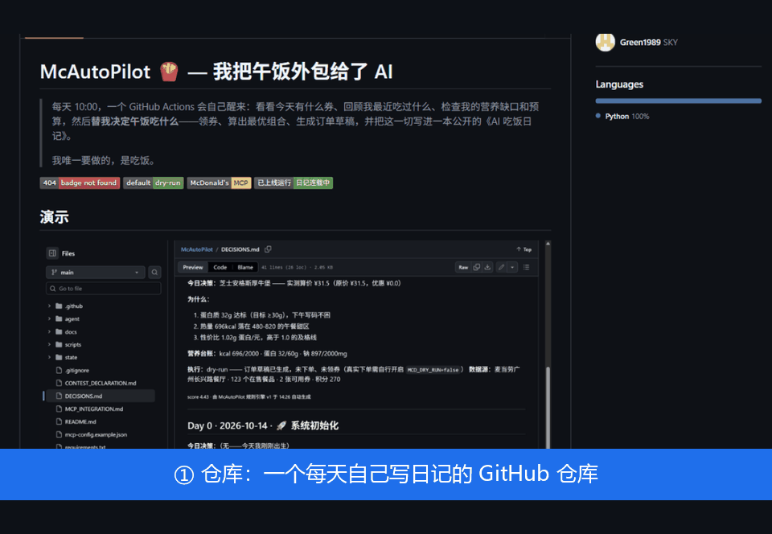

# McAutoPilot 🍟 — 我把午饭外包给了 AI

> 每天 10:00，一个 GitHub Actions 会自己醒来：看看今天有什么券、回顾我最近吃过什么、检查我的营养缺口和预算，然后**替我决定午饭吃什么**——领券、算出最优组合、生成订单草稿，并把这一切写进一本公开的《AI 吃饭日记》。
>
> 我唯一要做的，是吃饭。

[](.github/workflows/autopilot.yml)
[](agent/config.py)
[](https://mcp.mcd.cn)
[](DECISIONS.md)

## 演示



*动图内容：仓库首页 → [DECISIONS.md](DECISIONS.md)（AI 吃饭日记）→ GitHub Actions 运行日志（真实的感知-决策-算价输出）。所有数据来自麦当劳官方 MCP 的真实调用。*

## 为什么做这个

打工人每天都要回答人类历史上最难的问题之一：**中午吃什么？**

这个问题的痛点不在"没得选"，而在：
- 有 30 张优惠券，但不知道今天哪张最划算；
- 想吃点好的，又不想连续五天麦辣鸡腿堡；
- 昨天吃太咸了，今天其实该补点蔬菜——但谁会记得呢？

McAutoPilot 把这些决策全部交给一个每天自动运行的 Agent。它有记忆（你的点餐历史）、有约束（预算/营养）、有目标（好吃、划算、别重样），还有一本公开的决策日志——**每一次"它为什么这么选"都有据可查**。

## 它每天怎么思考

```
10:00 (cron) ──▶ 感知 ──▶ 决策 ──▶ 执行 ──▶ 记录
                 │         │        │        │
                 │         │        │        └─ DECISIONS.md + 营养台账
                 │         │        │           自动 commit（活仓库）
                 │         │        ├─ 订单草稿（默认 dry-run）
                 │         │        ├─ 可选：自动领券 + 真实下单（三重护栏）
                 │         │        └─ 可选：决策卡 webhook 推送
                 │         ├─ 营养缺口 + 预算 + 券 + 别重样 + 理由
                 │         ├─ v1 规则打分（默认，渐进发布中）
                 │         └─ v2 求解器（硬约束 + 加权目标，MCD_ENGINE 切换）
                 └─ 可用优惠券 / 历史订单 / 当日菜单（麦当劳 MCP）
```

每天一篇决策记录长这样（示意格式；**真实连载已在进行中** → [DECISIONS.md](DECISIONS.md)，第一篇 Day 1 由真实菜单/券/历史订单数据在 2026-10-14 生成）：

```markdown
## Day 12 · 2026-10-14 · ☀️ 周三

**今日决策**：板烧鸡腿堡 + 蔬菜沙拉 + 鲜煮咖啡 —— 实付 ¥27.0

**为什么**：
1. 连续 2 天麦辣鸡腿堡，辣度疲劳，引擎给出"换口味"加权 +0.3
2. 近 3 天钠摄入均值超标 18%，沙拉与咖啡的组合把今天拉回均衡
3. 「板烧买一送一」券今天到期，不用就浪费 —— 折上再省 ¥23
4. 预算 ¥35 以内达标，蛋白质 42g 达标

**营养台账**：kcal 562/2000 · 蛋白 42/60g · 钠 1050/2000mg
```

## 快速开始（fork-and-run）

**第 0 步（可选，先看效果）**：什么都不配，fork 后直接跑——没有 Token 会自动进入离线 Mock 模式，用模拟数据走完整个决策循环，先看看它怎么"思考"。

正式接入（约 5 分钟）：

1. **Fork 本仓库**（右上角 Fork 按钮）
2. 在 [open.mcd.cn](https://open.mcd.cn) 申请麦当劳 MCP Token（免费，需审核，建议尽早）
3. 你的 fork 仓库 → **Settings → Secrets and variables → Actions → New repository secret**：
   - Name 填 `MCD_MCP_TOKEN`，Value 填你的 Token（Secret 内容不会进代码、不会出现在日志里）
4. **Actions** 页启用 workflow（fork 默认禁用，点绿色按钮启用）
5. 建议先在 **Settings → Secrets and variables → Actions → Variables** 添加 `MCD_PREVIEW` = `true` 手动跑一次——用真实数据出一份决策预览（`state/preview.md`），确认一切正常后再删掉这个变量
6. 删掉 `MCD_PREVIEW` 后，每天北京时间 10:00 它会自动醒来写日记；日记会自动 commit 回你的 fork（fork 里自带 commit 历史的连载）

> 想调预算？Variables 里加 `MCD_BUDGET`（默认 40 元）。
> 想换决策引擎？`MCD_ENGINE=v2` 启用求解器（硬约束过滤 + 加权目标 + 分数构成明细）。
> 想动真格下单？除了 `MCD_DRY_RUN=false`，还需要**每天**把 `MCD_CONFIRM_ORDER` 设为当天日期（如 `2026-10-15`）作为二次确认，且实付超预算会被硬护栏拦下——订单只到"待支付"，支付永远人工完成。

## 项目结构

```
.github/workflows/autopilot.yml   # 每日 10:00 自动驾驶循环（含日记自动 commit + 决策卡推送）
agent/
  main.py                         # 主循环入口（python -m agent.main）
  config.py                       # 配置：Token 只从环境变量读，永不落仓库
  perceive.py                     # 感知层：菜单/券/历史订单/营养/积分 归一化
  brain.py                        # 决策引擎：v1 规则打分 / v2 求解器（硬约束+加权目标）
  executor.py                     # 执行链：自动领券 + 真实下单（三重护栏）
  ledger.py                       # 营养台账：滚动 7 天摄入与花费
  report.py                       # 日记渲染：DECISIONS.md 每日条目
  notify.py                       # 今日决策卡：企业微信/飞书/Discord/通用 webhook
  mcp_client/
    base.py                       # 客户端统一接口 + 返回文本 JSON 提取
    http_client.py                # 真实 MCP 客户端（Streamable HTTP + Bearer + 断连重试）
    mock_client.py                # 离线 Mock（工具名与返回结构对齐真实服务）
    fixtures/                     # 模拟菜单/券/订单数据
tests/                            # 单测：求解器约束 / 执行链护栏 / 决策卡渲染
scripts/
  probe_mcp.py                    # MCP 探针：摸清工具返回结构（内置脱敏）
docs/mcp-tool-samples/            # 真实 MCP 返回结构脱敏样例（决策引擎设计依据）
state/                            # 营养台账 / 决策状态 / commit 消息（随决策 commit）
DECISIONS.md                      # AI 吃饭日记（核心产出）
MCP_INTEGRATION.md                # 麦当劳 MCP 集成说明
CONTEST_DECLARATION.md            # 参赛声明（官方要求，不可改动）
```

## 配置项（全部可选，走环境变量 / Actions Variables）

| 变量 | 默认 | 说明 |
|---|---|---|
| `MCD_MCP_TOKEN` | 空 | 麦当劳 MCP Token；不设则自动进入离线 Mock 模式 |
| `MCD_DRY_RUN` | `true` | true = 只决策+算价草稿；false 才启用真实下单执行链 |
| `MCD_BUDGET` | `40` | 单餐预算上限（元，执行链硬护栏） |
| `MCD_PREVIEW` | `false` | true = 真实数据跑完整决策但只写预览，不落 DECISIONS.md（fork 试跑推荐先开这个） |
| `MCD_ENGINE` | `v1` | 决策引擎：`v1` 规则打分 / `v2` 求解器（硬约束+加权目标，日记带分数构成） |
| `MCD_CONFIRM_ORDER` | 空 | 下单二次确认：必须等于运行当天日期（YYYY-MM-DD），每天显式更新才持续授权 |
| `MCD_AUTO_CLAIM` | `false` | true = 每次运行先自动领取麦麦省可用券（零成本写操作） |
| `MCD_WEBHOOK_URL`（Secret） | 空 | 今日决策卡推送：企业微信/飞书/Discord/通用 webhook 自动适配 |

## 常见问题

**Token 安全吗？会不会泄露？**
Token 只通过 GitHub Secrets 注入环境变量，代码里零硬编码；仓库内的 `mcp-config.example.json` 只有占位符；本地开发走 `.env`（已 gitignore）。推送到 GitHub 前，作者对全部暂存内容做过 Token 值的全文扫描，零命中。

**它会不会乱下单、乱扣钱？**
不会，这里有四层保险：① 默认 `dry-run`，执行链止步于 `calculate-price`（纯计算接口）；② 真实下单需要显式设 `MCD_DRY_RUN=false`；③ 还需每天把 `MCD_CONFIRM_ORDER` 设为当天日期作为二次确认——日期每天变，忘改了就自动回到不下单状态；④ 实付超过 `MCD_BUDGET` 被硬护栏直接拦下。且 MCP 的下单接口只生成**待支付订单**，支付链接留给人工扫码，agent 全程不碰钱。

**它怎么知道"我"想吃什么？**
看三样东西：你的历史订单（换口味规则会惩罚连续重复）、你的营养台账（7 天滚动均值找缺口）、当天的券（不用就浪费）。它不猜口味玄学，每条理由都带数字。

**为什么选 GitHub Actions 当运行时？**
零服务器、零成本、天然公开——commit 历史就是这本日记的连载本身，fork 即私有部署。

## 设计原则

- **默认不动真格**：dry-run 是默认值，真实下单需要显式开启；
- **隐私不落仓库**：订单数据经字段白名单过滤后才写入决策日志，探针输出自动脱敏；
- **决策可解释**：不吃"黑盒推荐"，每一条决策附编号理由，日志就是审计记录；
- **活仓库即产品**：commit 历史就是这本日记的连载，star 它 = 订阅一个 AI 的午饭人生。

## 路线图

- [x] D1 感知链路：MCP 客户端 + Mock 模式 + Actions 定时任务
- [x] D2 决策引擎 v1（规则打分）+ DECISIONS.md 自动渲染与 commit + 营养台账
- [x] D3 演示 GIF + fork 指南完善 + 首波发布（掘金长文已发：[juejin.cn/spost/7696387828728594473](https://juejin.cn/spost/7696387828728594473)）
- [x] v2 求解器（硬约束 + 加权目标，`MCD_ENGINE=v2` 切换）+ 真实下单执行链（三重护栏）
- [x] webhook "今日决策卡"推送（企业微信/飞书/Discord 自动适配）
- [ ] 引擎调优观察：券命中率（配合 `MCD_AUTO_CLAIM` 自动领券）、组合多样性

## 大赛

本项目参加 **WorkBuddy × 麦当劳 程序员创意开发大赛**（基于[麦当劳官方 MCP](https://mcp.mcd.cn)）。参赛声明见 [CONTEST_DECLARATION.md](CONTEST_DECLARATION.md)，MCP 集成说明见 [MCP_INTEGRATION.md](MCP_INTEGRATION.md)。

## 免责与致谢

- 本项目为独立开发的参赛作品，与麦当劳官方无关；
- Mock 模式中的菜单价格与营养数据为演示用近似值，非官方数据；
- 感谢 [M-China](https://github.com/M-China) 提供的官方 MCP 服务与大赛机会。

## Star History

[](https://star-history.com)
